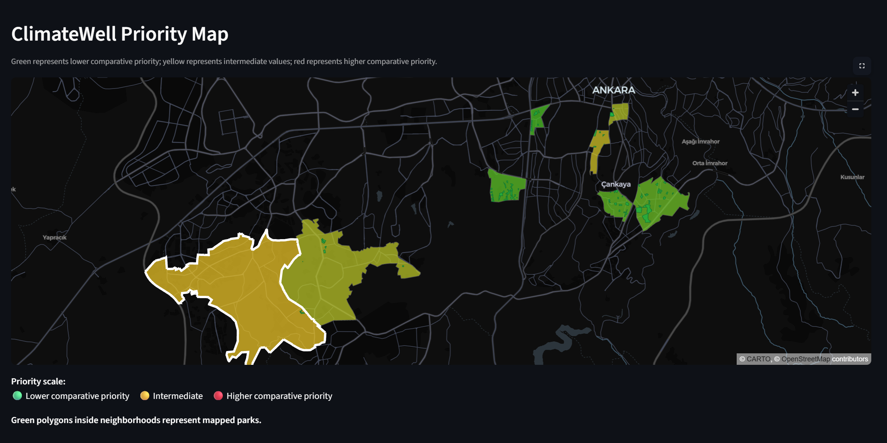

# 🌱 ClimateWell

### Urban Climate & Well-being Analytics with PostgreSQL, PostGIS & Python


**ClimateWell** is an urban analytics prototype that combines **park accessibility, population density, and summer heat exposure** to compare neighborhoods and identify areas that may deserve relatively higher attention.

The current pilot analyzes **8 neighborhoods in Çankaya, Ankara, Türkiye** using real-world spatial, demographic, and historical climate data.

> **Which neighborhoods may face a combination of limited park access, high population density, and greater heat exposure?**

**Open Data → Python ETL → PostgreSQL/PostGIS → Spatial SQL → Interactive Dashboard**

---

## 🖥️ Dashboard Preview



---

## ✨ Key Features

- 🗺️ **Spatial analysis with PostGIS**
- 🌳 **300 m park-accessibility analysis**
- 🌡️ **Summer heat-exposure analysis**
- 👥 **Population-density comparison**
- ⚡ **GiST spatial indexing and query optimization**
- 💾 **Materialized views for faster dashboard queries**
- 📊 **Interactive Streamlit + PyDeck dashboard**
- 🔐 **Environment-variable based database security**

---

## 🧠 ClimateWell Score

ClimateWell v0.1 combines three prototype indicators:

| Indicator | Weight |
|---|---:|
| Park Access Deficit | 40% |
| Population Density Risk | 30% |
| Heat Exposure | 30% |

```text
ClimateWell Score =
0.40 × Park Access Deficit
+
0.30 × Population Density Risk
+
0.30 × Heat Exposure
```

A higher score means a **higher comparative priority within the current pilot dataset**.

> ClimateWell is an exploratory prototype, not an official health, climate-risk, or municipal decision system.

---

## 🗺️ Pilot Area

Current pilot neighborhoods in Çankaya, Ankara:

- Alacaatlı
- Ayrancı
- Balgat
- Beytepe
- Birlik
- Çiğdem
- Kavaklıdere
- Yıldızevler

---

## 🖥️ Dashboard

The dashboard includes:

- neighborhood selection,
- ClimateWell Score,
- population and population density,
- 300 m park-accessibility percentage,
- number of days ≥35°C,
- average summer maximum temperature,
- neighborhood ranking,
- red-yellow-green priority map,
- hover-based map information,
- selected-neighborhood highlighting,
- mapped park polygons,
- score-component visualization,
- CSV export,
- methodology and limitations.

Map interpretation:

```text
🟢 Lower comparative priority
🟡 Intermediate
🔴 Higher comparative priority
```

---

# 🌳 Park Accessibility

Park polygons are obtained from **OpenStreetMap**.

ClimateWell estimates how much of each neighborhood lies within **300 meters of a mapped park**.

Conceptually:

```text
Mapped Parks
     ↓
300 m Buffers
     ↓
Intersection with Neighborhood
     ↓
Accessible Area
     ↓
Park Access %
```

PostGIS functions used include:

```sql
ST_Intersects()
ST_DWithin()
ST_Buffer()
ST_Intersection()
ST_Union()
ST_Area()
```

A lower park-access percentage produces a higher **Park Access Deficit**.

### Important limitation

The current metric measures **geometric proximity**, not actual walking distance.

It does not yet account for:

- street networks,
- pedestrian entrances,
- barriers,
- slope,
- crossings,
- real walking time.

---

# 🌡️ Heat Exposure

Historical temperature data is retrieved from the **Open-Meteo Historical Weather API**.

ClimateWell v0.1 analyzes:

```text
1 June 2025 – 31 August 2025
```

For each neighborhood the system calculates:

- average summer maximum temperature,
- hottest daily maximum temperature,
- number of days ≥35°C,
- number of days ≥38°C.

Heat exposure is calculated as:

```text
Days ≥35°C
──────────── × 100
Summer Days
```

The **35°C threshold is a prototype analytical choice**, not a universal medical or public-health threshold.

Open-Meteo values are grid-based historical estimates, not measurements from physical neighborhood sensors.

---

# 👥 Population Density

Population density is calculated as:

```text
Population
──────────────
Area (km²)
```

Neighborhood area is calculated from PostGIS geometries.

Population-density values are normalized comparatively across the current pilot neighborhoods.

---

# 🧮 Final Scoring Logic

The three components are combined as:

```text
40% Park Access Deficit
30% Population Density Risk
30% Heat Exposure
```

The current weights are manually defined prototype weights.

They have not yet been scientifically or municipally validated.

---

# 🧱 Architecture

```text
┌─────────────────────────────┐
│     External Data Sources   │
├─────────────────────────────┤
│ Ankara Metropolitan         │
│ Municipality                │
│ OpenStreetMap               │
│ Population Data             │
│ Open-Meteo                  │
└──────────────┬──────────────┘
               │
               ▼
┌─────────────────────────────┐
│       Python ETL Layer      │
├─────────────────────────────┤
│ requests                    │
│ JSON / GeoJSON              │
│ CSV                         │
│ psycopg2                    │
└──────────────┬──────────────┘
               │
               ▼
┌─────────────────────────────┐
│     PostgreSQL + PostGIS    │
├─────────────────────────────┤
│ Relational Tables           │
│ Spatial Queries             │
│ GiST Indexes                │
│ Views                       │
│ Materialized Views          │
└──────────────┬──────────────┘
               │
               ▼
┌─────────────────────────────┐
│     Streamlit Dashboard     │
├─────────────────────────────┤
│ PyDeck Map                  │
│ Metrics                     │
│ Charts                      │
│ CSV Export                  │
└─────────────────────────────┘
```

---

# 🗄️ Database Structure

Main tables:

```text
neighborhoods
parks
population_stats
temperature_records
```

Main analytical objects:

```text
climatewell_neighborhood_metrics
climatewell_full_metrics
climatewell_metrics_mv
climatewell_full_metrics_mv
```

---

# ⚡ Query Optimization

One of the main technical improvements involved optimizing a spatial distance query.

Before geography indexing:

```text
Execution Time: ~10.96 seconds
```

A GiST geography expression index was added:

```sql
CREATE INDEX IF NOT EXISTS idx_parks_geography
ON parks
USING GIST ((geometry::geography));
```

After indexing:

```text
Execution Time: ~0.20 seconds
```

Approximate improvement:

```text
~54.9× faster
```

This demonstrates the impact of proper spatial indexing in PostGIS.

---

# 💾 Materialized Views

Spatial calculations are relatively expensive.

Instead of recalculating all metrics every time the dashboard loads, ClimateWell uses materialized views.

Main dashboard-ready object:

```text
climatewell_full_metrics_mv
```

Refresh command:

```sql
REFRESH MATERIALIZED VIEW climatewell_full_metrics_mv;
```

This keeps dashboard reads fast while preserving more complex spatial analysis in the database.

---

# 🧠 SQL & PostGIS Concepts Used

ClimateWell includes practical use of:

```text
CREATE TABLE
PRIMARY KEY
FOREIGN KEY
UNIQUE
CHECK
INSERT
UPDATE
ON CONFLICT
JOIN
LEFT JOIN
GROUP BY
FILTER
CTE
WINDOW FUNCTIONS
VIEW
MATERIALIZED VIEW
INDEX
GIST INDEX
EXPLAIN ANALYZE
```

Selected PostGIS functions:

```text
ST_Area
ST_AsGeoJSON
ST_Buffer
ST_Centroid
ST_DWithin
ST_GeomFromGeoJSON
ST_Intersection
ST_Intersects
ST_IsValid
ST_SetSRID
ST_Transform
ST_Union
ST_X
ST_Y
```

---

# 📁 Project Structure

```text
ClimateWell/
│
├── app.py
├── README.md
├── requirements.txt
├── .gitignore
│
├── data/
│   ├── raw/
│   │   ├── cankaya_neighborhoods.geojson
│   │   ├── cankaya_parks.geojson
│   │   └── population_2025.csv
│   │
│   └── processed/
│       └── .gitkeep
│
├── sql/
│   ├── 02_create_parks.sql
│   ├── 03_create_metrics_view.sql
│   ├── 04_create_indexes.sql
│   ├── 05_create_materialized_view.sql
│   ├── 06_create_temperature_table.sql
│   ├── 07_create_full_climatewell_view.sql
│   └── 08_create_full_metrics_mv.sql
│
└── src/
    ├── fetch_neighborhoods.py
    ├── fetch_parks.py
    ├── fetch_temperature.py
    ├── load_neighborhoods.py
    ├── load_parks.py
    └── load_population.py
```

---

# 📂 Data Flow

```text
External Sources
      ↓
Python Fetch Scripts
      ↓
Raw GeoJSON / CSV
      ↓
Python Load Scripts
      ↓
PostgreSQL / PostGIS
      ↓
Spatial SQL
      ↓
Views / Materialized Views
      ↓
Streamlit Dashboard
```

---

# 🛠️ Technology Stack

### Database
- PostgreSQL
- PostGIS

### Programming
- Python
- SQL

### Python Libraries
- psycopg2-binary
- requests
- pandas
- streamlit
- pydeck
- python-dotenv

### Data
- GeoJSON
- CSV
- JSON

### Development
- Visual Studio Code
- Git
- GitHub
- Python Virtual Environment

---

# 🚀 Installation

Clone the repository:

```bash
git clone YOUR_REPOSITORY_URL
cd ClimateWell
```

Create a virtual environment:

```bash
python -m venv .venv
```

Activate it on Windows:

```powershell
.\.venv\Scripts\Activate.ps1
```

Install dependencies:

```bash
python -m pip install -r requirements.txt
```

---

# 🐘 PostgreSQL Setup

Create a database:

```sql
CREATE DATABASE climatewell;
```

Connect to it and enable PostGIS:

```sql
CREATE EXTENSION IF NOT EXISTS postgis;
```

---

# 🔐 Environment Variables

Create a `.env` file in the project root:

```env
DB_HOST=localhost
DB_PORT=5432
DB_NAME=climatewell
DB_USER=postgres
DB_PASSWORD=YOUR_PASSWORD
```

The `.env` file is excluded from GitHub.

Example `.gitignore` entries:

```text
.venv/
.env
__pycache__/
*.pyc
.streamlit/
.vscode/
```

---

# ▶️ Run the Dashboard

```powershell
python -m streamlit run app.py
```

Local address:

```text
http://localhost:8501
```

---

# 📚 Data Sources

ClimateWell v0.1 currently uses:

- **Ankara Metropolitan Municipality** — neighborhood boundaries
- **OpenStreetMap** — mapped park polygons
- **Open-Meteo Historical Weather API** — historical temperature estimates
- **2025 neighborhood population data** — population statistics

A future release should include full source URLs, retrieval dates, and detailed provenance information.

---

# ⚠️ Limitations

ClimateWell v0.1 is an exploratory prototype.

Current limitations include:

- only eight neighborhoods are included,
- OpenStreetMap completeness may vary,
- only mapped parks are currently included,
- forests and other green-space categories are not yet fully covered,
- park accessibility uses straight-line buffering rather than pedestrian routing,
- temperature values are grid-based estimates,
- population-density scores are normalized relative to the pilot dataset,
- the 35°C threshold is a prototype threshold,
- indicator weights are manually defined,
- the ClimateWell Score has not been scientifically or municipally validated.

Results should therefore be interpreted only as **comparative exploratory indicators**.

---

# 🔭 Future Work

Possible future improvements:

- full Çankaya coverage,
- full Ankara coverage,
- pedestrian-network accessibility,
- park-entrance analysis,
- NDVI,
- vegetation coverage,
- land-surface temperature,
- air-quality indicators,
- multi-year heat analysis,
- configurable weights,
- sensitivity analysis,
- automated ETL,
- scheduled data refresh,
- automated testing,
- Docker,
- public deployment,
- richer map interactions,
- API support.

---

# 🎓 What I Learned

ClimateWell was built as both a software project and a practical learning exercise.

The project strengthened practical understanding of:

- advanced SQL,
- PostgreSQL,
- PostGIS,
- spatial joins,
- spatial indexing,
- query execution plans,
- materialized views,
- GeoJSON,
- API integration,
- ETL pipelines,
- relational database design,
- interactive dashboards,
- responsible interpretation of environmental data.

A core principle of the project is:

> **Understand every query, every transformation, and every result — not just make the code run.**

---

# 🌍 Social Impact Perspective

ClimateWell was designed around a real urban challenge rather than as an abstract database exercise.

The project explores how open data and spatial databases can help reveal differences in:

- green-space accessibility,
- urban density,
- summer heat exposure.

The long-term goal is not to produce a definitive risk score, but to demonstrate how transparent data analysis can support discussions around urban well-being and climate resilience.

---

# 📌 Project Status

```text
Project: ClimateWell
Version: v0.1
Status: Working Prototype
Pilot Area: Çankaya, Ankara, Türkiye
Database: PostgreSQL + PostGIS
Dashboard: Streamlit + PyDeck
```

---

# 🛣️ Roadmap

- [x] Neighborhood boundaries
- [x] Park data
- [x] Population data
- [x] Historical temperature data
- [x] PostgreSQL/PostGIS database
- [x] Spatial park-access analysis
- [x] Population-density analysis
- [x] Heat-exposure analysis
- [x] ClimateWell Score
- [x] GiST indexing
- [x] Query optimization
- [x] Materialized views
- [x] Streamlit dashboard
- [x] Interactive map
- [x] CSV export
- [x] `.env` security
- [ ] Automated tests
- [ ] Complete database initialization script
- [ ] Public deployment
- [ ] Dashboard screenshots
- [ ] GitHub v0.1 release

---

# ⚠️ Disclaimer

**ClimateWell is an educational and exploratory software project.**

It is not intended to provide:

- medical advice,
- official climate-risk classifications,
- emergency guidance,
- public-health decisions,
- municipal planning decisions.

All scores should be interpreted only as **comparative prototype indicators derived from the current dataset and methodology**.

---

## 🌱 ClimateWell

**Data → Spatial SQL → Insight**

> Using databases not only to store cities, but to understand them.